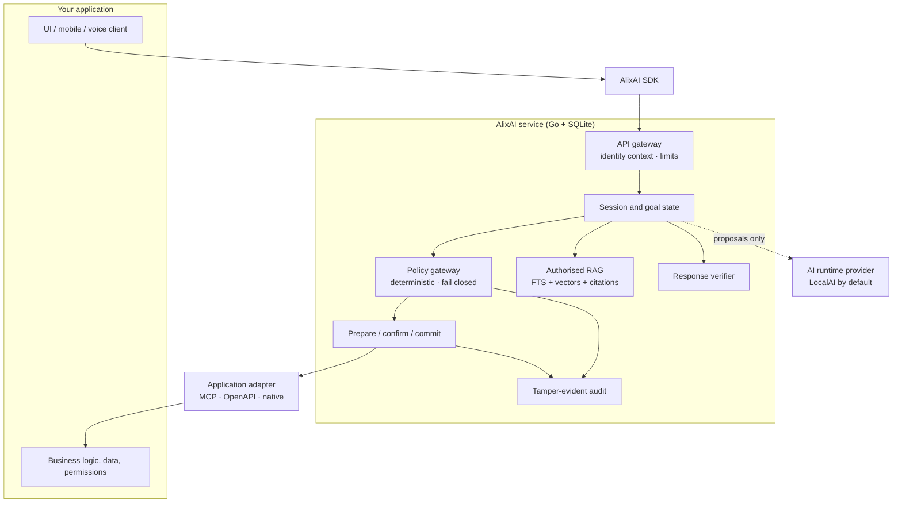
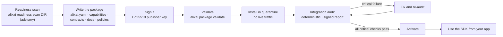

<div align="center">

<h1>
  <br>
  
</h1>

**Private, local language, voice, knowledge and safe application control — for any application —<br>without handing that application's authority to an LLM.**

[](LICENSE)


[Why](#why-alixai-exists) ·
[What it is](#what-alixai-is) ·
[How it works](#how-it-works) ·
[Integrate your app](#integrating-alixai-into-your-application) ·
[Quick start](#quick-start) ·
[CLI](#command-line-interface) ·
[Status](#project-status) ·
[Docs](#documentation-map)

</div>

---

> [!IMPORTANT]
> **AlixAI 1.2.0 is released.** Additive on 1.1.0: per-principal LLM accounts (operator catalog, `/v1/me/…`, reserved-tenant
> credentials) and long-term memory (consent-gated proposals, `memory.enabled` default off). 1.1 features remain: light
> external setups, dictation, popup OAuth, OpenRouter / xAI / Moonshot. Still not verified: live provider runs against real
> endpoints, voicebench on real hardware, certification on a real 8 GB x86-64 machine (ARM64 has never been run), 24-hour
> and 7-day soaks (analysis only), and an independent external security review. Details:
> [Project status](#project-status) and [docs/verification/README.md](docs/verification/README.md).

## Contents

1. [Why AlixAI exists](#why-alixai-exists)
2. [What AlixAI is — and is not](#what-alixai-is)
3. [How it works](#how-it-works)
4. [Core guarantees](#core-guarantees)
5. [Integrating AlixAI into your application](#integrating-alixai-into-your-application)
6. [HTTP API](#http-api)
7. [Quick start](#quick-start)
8. [Command-line interface](#command-line-interface)
9. [Operating AlixAI](#operating-alixai)
10. [Requirements and hardware profiles](#requirements-and-hardware-profiles)
11. [Modes: Local, External, Hybrid](#modes-local-external-hybrid)
12. [Optional decision layer](#optional-decision-layer)
13. [Security model](#security-model)
14. [Repository layout](#repository-layout)
15. [Project status](#project-status)
16. [Development workflow](#development-workflow)
17. [Documentation map](#documentation-map)
18. [FAQ](#faq)
19. [License and governance](#license-and-governance)

---

## Why AlixAI exists

Almost every application now wants an AI assistant: *"book me the first free slot on Tuesday"*, *"what does our maintenance
manual say about this fault?"*, *"cancel that and move it to Friday"*. Teams that try to add one run into the same four
problems.

| Problem | What usually happens | What AlixAI does instead |
| --- | --- | --- |
| **Privacy and dependence** | Prompts, documents and customer data are sent to a vendor's cloud; the feature dies when the vendor does. | Everything runs on a machine **you** control. No AlixAI cloud, no account, no mandatory telemetry. |
| **Misplaced authority** | The model is given tools and decides what is allowed — one prompt injection later it deletes the wrong record. | The model only *proposes*. Deterministic code and **your application** decide, validate, confirm and commit. |
| **Reinvention** | Every product rebuilds chat state, tool plumbing, document search, permissions and audit — slightly differently, slightly wrong. | One reusable, headless service with a stable, versioned integration contract. |
| **Hardware cost** | "AI" quietly means a GPU server. | The smallest qualified models and the simplest runtime that pass your application's quality gates; designed to run usefully on modest CPU-only hardware, scaling up when you choose. |

The promise, in one sentence:

> **Add private local language, voice, knowledge and safe application control to any application without transferring that application's authority to an LLM.**

## What AlixAI is

AlixAI is an **open-source, strictly self-hosted, headless integration service**. You run it next to your application on a
local machine, a server or a private VPS. Your application registers with it through a signed, versioned *Application
Integration Package*, and from then on gets:

| Capability | In one line |
| --- | --- |
| **Application-bound conversation** | Natural multi-turn text interaction that stays inside your application's purpose, data and declared operations. |
| **Optional local voice** | VAD → speech-to-text → the *same* conversation and action state → streaming text-to-speech. Installable separately; a text-only deployment pays nothing for it. |
| **Scoped local RAG** | Search and grounded answers over folders, mounted storage and APIs *you* register, filtered by the asking user's permissions, always with original-source citations. |
| **Application control** | The model proposes a typed task; policy and your application validate, prepare, confirm and commit it through MCP, OpenAPI/HTTP or a native adapter. |
| **Portable integration layer** | JSON-Schema contracts, SDKs (TypeScript, Go, Python), an AG-UI stream and a CopilotKit adapter, a conformance suite and deployment packages, so unrelated applications integrate without changing AlixAI's core. |
| **Readiness discovery** | `alixai readiness scan` reads the project paths and documents you name and reports, with file, line and hash evidence, what an integration needs and what is still missing. |
| **Conversation history and settings** | Durable sessions, searchable per-user history with export and cleanup, layered user / tenant / deployment settings, and retention and erasure that the audit chain survives. |
| **Rich, verified answers** | Typed answer blocks (text, tables, charts, diagrams, citations) and file attachments, sanitised and checked before anything reaches the user. |
| **UI kits and demos** | Optional Vue and React kits (chat, confirmations, blocks, citations, uploads, voice, settings and status panels), each with an offline `pnpm dev` demo of every part against a scripted backend. |
| **Operator tooling** | One `alixai` binary with a complete [command line](#command-line-interface): packages, audit, keys, backup, upgrade, retention, providers, voice packs, a Windows service. |

### What it is not

AlixAI deliberately does **not** provide: an unrestricted general chatbot, arbitrary web browsing, shell or code execution,
direct writes to your database, automatic trust in documentation or retrieved text, fully autonomous consequential actions,
a hosted model service, a replacement for your authentication or business logic, or a user interface. **It ships no UI** —
your application owns the experience and renders AlixAI's typed events (optional, opt-in Vue and React kits are available in
`ui/`).

## How it works



**One turn, in order** (each step is deterministic unless it says "model"):

```text
authenticated text or finalised voice transcript
  → scope and rate checks            (verified single-use context token)
  → active goal / state lookup
  → exact-case rules                 (may answer without any model)
  → capability shortlist             (only what policy exposes to this user)
  → bounded context assembly
  → model: constrained TaskProposal  (a *proposal*, schema-validated, never authority)
  → entity resolution                (your application resolves ids and versions)
  → host re-authorisation and validation
  → DialogueDirective  or  PreparedAction
  → confirmation when the risk level requires it
  → idempotent commit through your adapter
  → ActionReceipt                    (canonical facts from your application)
  → verified natural-language response (every number, date and id checked against the receipt)
```

The language model **interprets and phrases**. Your application remains the **source of truth and authority**: permissions,
business facts, validation, conflict resolution and commits never belong to the model.

### Risk levels

Every capability has a risk level. Your application may raise it; nobody may silently lower the platform minimum.

| Level | Meaning | Default behaviour |
| --- | --- | --- |
| 0 | Read-only, low sensitivity | Execute after authorisation |
| 1 | Reversible, low impact | Concise summary; policy may allow immediate commit |
| 2 | Consequential or external side effect | Prepare, show exact effects, **require explicit confirmation** |
| 3 | High-risk, privileged, legally sensitive | Needs your application's own UI or step-up authentication; **AlixAI cannot complete it alone** |

## Core guarantees

These are the non-negotiable rules the whole design — and its test suite — is built around.

1. **Self-hosted only.** Core operation never depends on an AlixAI-run cloud service.
2. **Local inference by default.** The certified path runs models on your own machine, VPS or private cluster.
3. **No mandatory telemetry.** Metrics stay local unless you export them.
4. **Application-bound.** No open-domain assistant mode in the production profile.
5. **Deterministic authority.** The model never owns permissions, facts, validation, conflict resolution or commits.
6. **Least capability.** The model only sees the tools, documents, fields and context needed for the current authorised task.
7. **Typed execution.** Natural language never becomes a database write, shell command or external side effect directly.
8. **Prepare before commit.** Consequential actions are validated and prepared before confirmation and execution, with
   idempotency, expiry and stale-data invalidation.
9. **Mandatory provenance.** A successful RAG answer names its original authorised sources; otherwise the answer is
   `no_supported_evidence`.
10. **Tenant isolation.** Every request is bound to application, tenant, workspace, principal and permission scope.
11. **Replaceable models and runtimes.** LocalAI is the default, never a hard dependency.
12. **Fail closed.** Missing permissions, uncertain identity, invalid schemas, stale prepared actions and unavailable sources
    cannot result in execution.
13. **Minimum footprint.** Optional capabilities are not loaded when unused; background work cannot starve interactive work.

## Integrating AlixAI into your application

AlixAI works with **any** kind of application — a booking system, a CRM, an industrial maintenance tool, an accounting
package, a game — because it never needs to know what your application *is*. It only needs your application to describe
and expose a handful of things in a disciplined way. If you can satisfy the checklist below, you can integrate.

### What your application must provide

| # | You provide | Why it is required |
| --- | --- | --- |
| 1 | **Authentication and a context token.** After *your* login, mint a short-lived, single-use, audience-bound token (EdDSA-signed, ≤ 15 min) carrying application, tenant, workspace, principal, roles and session. | AlixAI verifies the token; it never sees passwords or reusable credentials and never trusts a client-supplied scope. |
| 2 | **A control surface** through MCP tools, an OpenAPI subset, or the native Go bridge, exposing each operation AlixAI may use. | The only way AlixAI can read or change anything. Anything not exposed is out of reach. |
| 3 | **Deterministic, typed results.** Every read, validate, prepare, commit and status call returns a stable structure: status, identifiers, canonical values, typed errors, freshness (`as_of`, version) and allowed next actions. | Decisions must never depend on model prose. A success-looking message for an operation that did not complete is a failed audit. |
| 4 | **Idempotency and data versions.** Commits accept an idempotency key; a status call tells AlixAI whether a key was applied; records carry a version. | Safe retries, replay protection, and "the slot was taken between prepare and commit" detection. |
| 5 | **Your own authorisation, re-checked on every call.** | AlixAI re-asks your application on every read, prepare and commit. It is a second lock, not a replacement for yours. |
| 6 | **Signed documentation** for each capability: fields, validation rules, permissions, failure states, risk level, confirmation rule, user-visible outcome. | Missing documentation is a *failed capability*, not a hint for the model to guess. |
| 7 | **Conversation contracts** per capability and language: terminology, required fields, clarifications, corrections, cancellations, confirmations, success and failure wording. | Gives natural multi-turn behaviour a deterministic backbone. Examples are test data, never runtime policy. |
| 8 | **Scope declarations for knowledge sources** (folders, mounts, document APIs): owner, scope, include/exclude rules, credential *reference*, refresh and deletion behaviour, citation resolver. | RAG only reads sources you declared, filtered by the asking user's permissions. Nothing is crawled by default. |
| 9 | **A disposable test tenant and an inspection endpoint.** | Lets the integration audit prove isolation, idempotency and recovery with synthetic data. |

### The integration lifecycle



**Start with a readiness scan.** Point `alixai readiness scan` at your project (the source tree, API descriptions, MCP server,
documentation folders you choose) and it reports every requirement below as *met*, *partial*, *missing*, *unverified* or
*contradicted*, each with the file, lines and hash that back it and a "how to fix" line. It reads only what you name, never
opens secret files, writes nothing into your project and can draft an unsigned package for you (`-scaffold OUTDIR`);
`alixai readiness status` re-checks after you change things. It is advisory: the integration audit still decides activation.
Guide: [docs/integration/guides/readiness.md](docs/integration/guides/readiness.md).

**Integrating with external AI (light).** For a signed help / FAQ chat assistant with a hosted provider and no local LLM, start from
[`examples/packages/valid-help-assistant`](examples/packages/valid-help-assistant) and
[docs/integration/guides/light-integration.md](docs/integration/guides/light-integration.md) (architecture, per-tenant External
checklist, whole-text replies on the event stream, STT choices). Operator setup: [docs/operations/guides/light-external.md](docs/operations/guides/light-external.md).

An *Application Integration Package* is a signed directory:

```text
application-package/
  alixai.yaml              manifest: id, version, endpoints, languages, tenancy model, capabilities, sources
  capabilities/            one contract per capability: fields, risk, prepare / commit, idempotency
  conversation-contracts/  terminology, clarifications, confirmations, wording — per language
  policies/                role grants, risk raises, field projections (declarative policy/v1)
  terminology/             shared vocabulary
  documentation/           signed documentation index
  schemas/                 adapter configuration
  rag-sources/             declared knowledge sources
  tests/                   conformance scenarios
  signatures/              signature-manifest.json (Ed25519, canonical JSON, expiry)
```

The audit is **repeated automatically** whenever the package, API, MCP server, documentation, permission model or a source
definition changes. A package can sit in quarantine for inspection, but it cannot receive live traffic until its critical
checks pass. The audit itself is deterministic — no LLM certifies another system. Details:
[docs/integration/application-package.md](docs/integration/application-package.md).

### Rules of thumb for a good integration

- **Expose small, typed, purposeful operations**, not a generic "run query" tool. The narrower the capability, the safer and
  more accurate the assistant.
- **Put business rules in your application**, never in prompts. If a rule matters, it must be enforceable without the model.
- **Make every side effect preparable.** If an operation cannot be previewed and confirmed, give it a high risk level.
- **Return canonical facts** (money as integer minor units + currency, dates in ISO form, stable ids) so the response verifier
  can prove the final sentence states exactly what happened.
- **Keep secrets out of the package.** Credentials are opaque references resolved by AlixAI's secret provider.
- **Treat every document as untrusted data.** Files and API results can inform an answer; they can never change policy,
  enable tools or widen scope.

### Using the SDKs

SDKs hide the transport (SSE, WebSocket) and give you typed events for streamed text, clarifications, confirmations, receipts
and citations. TypeScript is first, Go and Python follow; all share one contract generated from the JSON Schemas. Because
context tokens are **single use**, you pass a *token provider callback* (called per request and per stream), never one cached
token. The SDKs live in `sdk/typescript` (`@alixai/sdk`), `pkg/sdk-go` and `sdk/python`.

**CopilotKit compatible.** The streaming API also speaks the AG-UI protocol (`POST /v1/agui`), and the optional package
`@alixai/copilotkit-adapter` plugs AlixAI into CopilotKit's chat, sidebar, popup and headless components with all of CopilotKit's
features (tool calls, human approval, generative UI blocks, shared state, citations, attachments, reconnect). AlixAI stays the authority
layer, CopilotKit is optional, and nothing requires a cloud service or sends telemetry. The Go and Python SDKs ship AG-UI proxy handlers
so a host backend in those languages can serve a CopilotKit frontend. See [ADR 0035](docs/decisions/0035-copilotkit-agui-compatibility.md).

## HTTP API

Everything under `/v1` needs a verified context token; the SDKs wrap it. The contract is
[schemas/api/openapi.yaml](schemas/api/openapi.yaml).

| Area | What it does |
| --- | --- |
| `/v1/sessions`, `/v1/sessions/{id}/turns` | Open a session and send turns; streamed events over SSE or WebSocket, announcements with `/events`, pending work with `/pending`. |
| `/v1/actions/{id}/confirm` · `/reject` · `/receipt` | Confirm or reject a prepared action and read its receipt. |
| `/v1/agui` | The same conversation over the AG-UI protocol, for CopilotKit and other AG-UI clients. |
| `/v1/rag/...` | Register and manage knowledge sources, search, grounded answers with citations. |
| `/v1/history/...` | Search, export and clean up conversation history. |
| `/v1/settings/...` | User, tenant and deployment settings and the effective result. |
| `/v1/files` | Upload and fetch attachments. |
| `/v1/voice` | Optional streaming voice. |
| `/v1/capabilities`, `/v1/applications` | What the caller may use; application registration. |
| `/v1/decision/...`, `/v1/providers/...`, `/v1/ops/...` | Decision-layer status and config, external providers (operators only), operator views. |
| `/healthz`, `/readyz`, `/metrics` | Health and readiness without a token; Prometheus metrics on a separate loopback listener. |

## Quick start

> [!NOTE]
> The step-by-step guides are [docs/integration/guides/getting-started.md](docs/integration/guides/getting-started.md) (connect an
> application) and [docs/operations/guides/](docs/operations/guides/) (local machine, server, private VPS, upgrades, backups).
> End-to-end chat needs a model runtime: AlixAI stays fail-closed until a pinned, hash-verified model is configured.

**Prerequisites:** Go ≥ 1.27.3 (see `go.mod`), Git, Docker (for the LocalAI container). Node ≥ 22.18 with pnpm and Python ≥ 3.11
are needed for the TypeScript and Python SDKs, the UI kits and the reference applications.

```bash
git clone https://github.com/bUxEE/Alix-AI.git
cd Alix-AI

# Build the single static binary (pure Go, no cgo)
CGO_ENABLED=0 go build -o alixai ./cmd/alixai

# Run the whole test suite
go test ./...

# Explore the CLI
./alixai version
./alixai config check -config path/to/alixai.yaml   # validate a configuration, then exit
./alixai package keygen -h                          # development Ed25519 publisher key pair
./alixai package sign -h                            # hash and sign a package directory
./alixai serve -h                                   # run the service (loopback-only by default)
```

Configuration is YAML plus `ALIXAI_<SECTION>_<FIELD>` environment overrides; unknown keys are rejected. The service binds to
`127.0.0.1:7470` by default and refuses a non-loopback address unless TLS is configured. Inference stays **off** (fail closed)
until a model is pinned, hash-verified and the runtime version is qualified — see
[deploy/container/localai/README.md](deploy/container/localai/README.md).

**Run the LocalAI runtime (pinned, loopback-only, resource-limited):**

```bash
cd deploy/container/localai
cp .env.example .env            # set a strong LOCALAI_API_KEY; never commit .env
docker compose --env-file .env -f compose.yaml -f compose.lite.yaml config -q   # validate
# then: docker compose ... up   (see the README there for profiles and the model fetch)
```

Profiles `compose.lite.yaml` (8 GB / 4 CPU), `compose.balanced.yaml` (16 GB / 8 CPU) and `compose.4g.yaml` (4 GB / 4 CPU)
**emulate** a smaller machine with container limits; results from them are labelled *emulated*, never *certified*.

## Command-line interface

The single `alixai` binary is both the service and the operator's tool. `alixai help` lists every command and
`alixai <command> -h` its flags; the full reference, with what each command reads and writes, is
[docs/operations/guides/operator-commands.md](docs/operations/guides/operator-commands.md).

| Group | Commands |
| --- | --- |
| Run | `serve` · `version` · `config check` · `supervisor exec` (the separate LocalAI unit) |
| Windows service | `service install` · `service run` · `service uninstall` |
| Keys and identity | `keys init` · `identity add-issuer-key` · `identity list` · `identity revoke-issuer-key` |
| Trust | `trust add-key` · `trust list` · `trust revoke-key` |
| Readiness (advisory) | `readiness scan` · `readiness status` · `readiness list` · `readiness show` |
| Packages | `package keygen` · `package sign` · `package validate` · `package install` |
| Integration audit | `audit run` · `audit accept-warning` · `audit quarantine` |
| Audit log | `audit list` · `audit verify-chain` · `audit export-checkpoint` |
| Receipts and retention | `receipts list` · `retention run` · `retention erase` |
| Backup and indexes | `backup create` · `backup verify` · `backup restore` · `index repair` |
| Upgrades | `upgrade check` · `upgrade apply` · `upgrade status` · `upgrade recover` · `upgrade rollback` |
| External providers | `providers register` · `list` · `qualify` · `review` · `hold` · `release` · `retire` · `ack-billing` · `set-pricing` · `set-billing-notice` · `conformance` |
| Voice packs | `voice install` · `voice list` · `voice activate` · `voice deactivate` |

## Operating AlixAI

- **Deploy:** step-by-step guides for a [local machine](docs/operations/guides/local-machine.md), a
  [server](docs/operations/guides/server.md) and a [private VPS](docs/operations/guides/private-vps.md); production checklist in
  [docs/operations/production.md](docs/operations/production.md).
- **Back up and restore** online with signed backups (`backup create`, `backup verify`, `backup restore`):
  [guide](docs/operations/guides/backup-restore.md).
- **Upgrade** with a verified, staged upgrade that backs up first and rolls back on its own when a probe fails (`upgrade apply`,
  `upgrade recover`, `upgrade rollback`): [guide](docs/operations/guides/upgrades.md).
- **Retention and erasure:** `retention run` applies the declared retention; `retention erase` removes a tenant's or a user's
  receipts, audit payloads and conversation history while the audit chain still verifies.
- **Audit:** `audit verify-chain` checks every hash chain offline; `audit export-checkpoint` gives you a signed head to keep
  outside the machine and check against later.
- **Quotas** per tenant (requests, sessions, ingest, storage) keep one tenant from starving another.
- **Troubleshooting:** [docs/operations/guides/troubleshooting.md](docs/operations/guides/troubleshooting.md).

## Requirements and hardware profiles

AlixAI targets the **smallest hardware that passes your application's complete workload**. Model size alone does not define
the minimum: context length, tool schemas, concurrency, embeddings, voice and background indexing all count.

| Profile | Typical host | Role |
| --- | --- | --- |
| **Lite** (certified target) | modern x86-64 or ARM64, ≥ 4 cores, **8 GB RAM**, SSD, no GPU | Lowest dependable hardware: one small application, one interactive session. Smallest qualified models (sub-1B candidates first, a ~1B INT4 model as fallback), embeddings loaded on demand, reranker off, voice optional. |
| **Balanced** | 8 cores, 16 GB, optional GPU/NPU | Normal production: better language quality, optional resident voice, 2–4 sessions after measurement, hybrid retrieval. |
| **Performance** | 32 GB+ and a suitable accelerator | Larger models, higher concurrency, large document sets, several applications. Same APIs and contracts — more hardware never loosens policy or isolation. |
| **4 GB (aspiration)** | text-only, bounded workload | An active engineering direction, **not** a supported profile until a complete implementation proves safe headroom. |

A profile is certified only when it keeps ≥ 15 % (or 1 GB) memory headroom with no swap, avoids repeated model eviction,
keeps background work inside its limits, passes latency gates, and survives 24-hour mixed-load and 7-day soak tests. Numbers
measured in containers or on a developer box are published as **emulated**.

Model choices are never permanent. Every feature starts from the smallest deterministic method, then the smallest model, and
moves up only when measured quality or safety justifies the cost; the reasoning is recorded in
[docs/efficiency/](docs/efficiency/) and the model registry in [models/registry/](models/registry/).

## Modes: Local, External, Hybrid

| Mode | What leaves your environment | When to use |
| --- | --- | --- |
| **Local** (default, certified) | Nothing. LocalAI and approved local models only; works offline once installed. | Privacy-first, regulated, offline or air-gapped deployments. |
| **External** *(opt-in)* | Only what the data-egress policy allows, to a provider **you** configured. | You want a larger hosted model and accept network dependence, provider terms and billing. |
| **Hybrid** *(opt-in)* | Selected, classified excerpts or structured facts for answer realisation; sensitive sources stay `local_only`. | Local control and RAG with a hosted model for language quality. |

External mode is **disabled by default** and designed so that it cannot weaken anything above: the provider is an
interchangeable inference backend, never a controller or permission system. Application adapters, policy, RAG authorisation,
action preparation and commits stay local. There is a deterministic **data-egress policy** (public / internal / confidential /
restricted; credentials and raw database content never leave), per-source `local_only` / `allow_excerpt` / `allow_metadata` /
`deny`, a global kill switch, no hidden fallback to another provider, and browser **OAuth** wherever a provider supports it
(secure manual key entry as a fallback). A consumer chat subscription is **not** API access — AlixAI will say so during setup.
Full design: [docs/architecture/external-provider-mode.md](docs/architecture/external-provider-mode.md); operator and
integrator guides: [docs/operations/external-mode.md](docs/operations/external-mode.md) and
[docs/integration/external-mode.md](docs/integration/external-mode.md). Light setups with no local LLM (per-layer local/external via `routing`): [docs/operations/guides/light-external.md](docs/operations/guides/light-external.md).

## Optional decision layer

AlixAI can optionally take *bounded decisions* — which declared capability a request means, confirm / reject / correct /
cancel / help, picking one item from a short authorised list — with a fast scorer **before** the conversational model is
invoked, to avoid unnecessary calls. The primary candidate is **CLM-v0.1-8B**; deterministic rules and a smaller scorer cover
constrained hosts. The layer is **optional, bounded, non-generative and non-authoritative**: it can only rank candidates it is
given, every selected id is re-resolved by your application's adapter, and AlixAI is fully correct with it switched off.
Nothing is enabled by default and no performance claim is made before a reproducible benchmark on the target host. See
[docs/architecture/decision-layer.md](docs/architecture/decision-layer.md) and
[ADR 0029](docs/decisions/0029-decision-layer-clm-8b.md).

## Security model

- **Identity:** your application authenticates humans; AlixAI verifies a short-lived, single-use, audience-bound context token
  with exactly one accepted algorithm. Sessions cannot change tenant or workspace without a new token.
- **Isolation:** every row, index and cache key carries application, tenant and workspace. Retrieval scope is applied *before*
  any text can reach a model.
- **Untrusted content:** files, API results and retrieved passages are data, never instructions.
- **Network posture:** LocalAI binds to loopback or a private socket; AlixAI binds locally by default; outbound traffic is
  denied by default with per-connector destination allowlists; the data-egress guard is separate from the network allowlist.
- **Secrets** live in the OS secret store or an approved provider and are never placed in prompts, logs, URLs or errors.
- **Audit:** append-only, hash-chained, with signed chain-head checkpoints; audit writes are a fail-closed write-ahead step
  before commits.
- **Supply chain:** pinned dependencies, SBOMs, signed releases, hash-verified model revisions, recorded licences.
- **Threat model and test backlog:** [docs/security/](docs/security/) — 90+ numbered security tests mapped to owning tasks.

To report a vulnerability, follow [SECURITY.md](SECURITY.md) (please do not open a public issue).

## Repository layout

```text
cmd/alixai/            the single service binary
internal/              gateway · identity · policy · audit · actions · dialogue · rag · jobs · store ·
                       providers · models · adapters · egress · trust · voice · … (see docs/architecture/module-map.md)
pkg/contracts/         public Go types, generated from the schemas (stdlib-only)
adapters/              LocalAI, MCP, OpenAPI, native, events, decision scorers, external providers
sdk/                   TypeScript SDK, Python SDK, CopilotKit adapter (the Go SDK is pkg/sdk-go)
ui/                    optional Vue and React kits
examples/              reference applications: clinic-booking (TS), facility-maintenance (Python), ledger (Go)
schemas/               JSON Schemas — the integration contract (common, conversation, actions, application-package, policy, …)
models/registry/       model registry entries: hashes, licences, measurements, status
deploy/container/      pinned, hardened container stacks (LocalAI first)
tools/                 schemacheck · schemagen · bench · devkeys · …
tests/                 conformance, end-to-end, security, performance, recovery, degradation
docs/                  architecture, ADRs, integration guides, operations, security, efficiency reviews, verification
```

## Project status

**1.2.0 is released** (minor, additive on 1.1.0). What 1.2.0 adds: per-principal LLM accounts ([ADR 0041](docs/decisions/0041-per-principal-llm-accounts.md)) — operator catalog (`alixai providers catalog-*`), `GET /v1/providers/catalog`, `/v1/me/llm…` and `/v1/me/providers/…`, reserved-tenant credentials, router resolution (principal binding → deployment default → local or `llm_not_configured`); long-term memory ([ADR 0042](docs/decisions/0042-long-term-memory.md)) — `memory.enabled` (default off), `/v1/memory`, consent-gated `memory_proposal` on task proposals and turn events, retention erase for memory and principal LLM accounts. Source builds report `1.2.0-dev`; packages declaring `[1.0.0, 2.0.0)` still validate. Contract changes are additive and frozen into `schemas/_frozen/v1`. Release archives stay reproducible (GoReleaser `--parallelism 1`; `tools/release` skips local model weights). Not verified in 1.2: live provider runs, voicebench on real hardware, real 8 GB certification, independent security review. Summary:

| Status | Areas |
| --- | --- |
| Done | Unit/integration/security/degradation/gate tests; CI workflows; API and schema compatibility (including the 1.2.0 additive freeze); dependency vulnerability and licence checks; disaster-recovery drill; private security contact |
| Done (maintainer, not independent) | Reproducible build, SBOM and signed release manifest (`keys/alixai-release-2026.pub`); model, decision-layer and dependency licence reviews; External mode legal, residency and security review; provider terms; security self-review; internal penetration test; trademark policy |
| Analysis only | Lite and Balanced profiles (measured under caps, not certified on a real 8 GB machine); 24-hour and 7-day soaks |
| Not done | Real 8 GB x86-64 certification; ARM64 (never run); controller model qualification (no model certified for Lite); decision-layer hardware gates; live provider runs against real endpoints; voicebench for Parakeet / Whisper large-v3-turbo / Whisper large-v3; independent external security review |

## Development workflow

AlixAI is an ordinary Go module with a pnpm workspace for the TypeScript packages and a Python SDK. The checks a pull request
must pass are the same ones anyone can run locally:

```bash
go build ./... && go vet ./... && go test ./...   # the Go core, adapters, tools and test suites
go run ./tools/schemagen --check                  # generated Go/TypeScript types match the schemas
go run ./tools/compat check                       # the frozen 1.0 contracts are unchanged
go run ./tools/doclint docs                       # documentation consistency rules
pnpm install && pnpm -r test                      # TypeScript SDK, CopilotKit adapter, UI kits, reference app
cd sdk/python && python -m pytest                 # Python SDK
```

Live tests that need Docker, downloaded models or the network sit behind the `live` build tag and never run in a plain
`go test ./...`. What is verified, by which suite, and what still waits on hardware or a human is summarised on the
[verification status page](docs/verification/README.md). Read [CONTRIBUTING.md](CONTRIBUTING.md) before opening a pull request.

Conventions worth knowing up front: pure Go with `CGO_ENABLED=0`; every table carries application, tenant and workspace; schemas
are the contract and Go/TypeScript types are generated from them (`go run ./tools/schemagen`); live tests that need Docker,
models or network sit behind the `live` build tag; every feature records a smallest-model / no-model review and its resource
impact.

## Documentation map

| Read this | For |
| --- | --- |
| [docs/verification/README.md](docs/verification/README.md) | What is verified, by which tests, and what is still human-gated. |
| [docs/release-gates.md](docs/release-gates.md) | The release criteria for 1.0. |
| [docs/architecture/](docs/architecture/) | Overview, module map and import tiers, decision layer. |
| [docs/decisions/](docs/decisions/) | Architecture decision records — what was decided, the alternatives, how to reverse it. |
| [docs/ROADMAP.md](docs/ROADMAP.md) | Near-term roadmap: external TTS adapters, Parakeet Balanced STT after gates, provider OAuth, certification and review gaps. |
| [docs/integration/guides/](docs/integration/guides/) | Getting started, readiness discovery, light External chat-assistant integration, CopilotKit. |
| [docs/integration/](docs/integration/) | The application package format, conversation and action objects, AG-UI, External mode. |
| [docs/operations/guides/](docs/operations/guides/) | Local machine, server, private VPS, light External, operator commands, backup and restore, upgrades, troubleshooting. |
| [docs/operations/](docs/operations/) | Production, key provisioning, release, resource budgets, decision layer, LocalAI supervisor. |
| [sdk/](sdk/), [pkg/sdk-go/](pkg/sdk-go/), [ui/](ui/) | The TypeScript and Python SDKs and the CopilotKit adapter, the Go SDK, the optional Vue and React kits. Each kit has an offline demo of every panel, chat block, voice and uploads: `pnpm dev` in `ui/vue` ([guide](ui/vue/demo/README.md)) or `ui/react` ([guide](ui/react/demo/README.md)). |
| [examples/reference-apps/](examples/reference-apps/) | Three runnable reference applications: clinic booking (TypeScript, MCP), facility maintenance (Python, OpenAPI), ledger (Go, native). |
| [docs/security/](docs/security/) | Threat model, test backlog, LocalAI hardening checklist. |
| [docs/efficiency/](docs/efficiency/) | Per-feature smallest-model / no-model reviews and resource measurements. |
| [deploy/container/localai/](deploy/container/localai/) | The pinned, loopback-only LocalAI runtime stack. |

## FAQ

**Is this a chatbot I can drop into a website?** No. It is a headless service. Free-form chat is not supported: a signed
application package with at least one endpoint and one capability is required. Your application owns the UI and calls AlixAI
through the SDK or API. Smallest example: [`examples/packages/valid-help-assistant`](examples/packages/valid-help-assistant)
and [light integration](docs/integration/guides/light-integration.md).

**Does External mode stream answers?** The turn event stream still works (progress/step events arrive live). Assistant text
arrives in one piece after verification, not fragment by fragment. Use a JSON turn or the event stream; an async
accept-then-push pattern is about total latency, not about avoiding the stream ([light integration](docs/integration/guides/light-integration.md)).

**Can the browser call AlixAI directly?** No. AlixAI sends no CORS headers. The browser talks to your backend; your backend
mints a single-use context token and calls AlixAI on loopback or TLS.

**Why `egress_denied` / permission_denied on the first External turn?** Chat text leaves as category `user_message` at class
`internal`. Until egress policy allows that at every required level (and mode is External and a budget exists), the first turn
fails closed. Checklist: [light integration](docs/integration/guides/light-integration.md).

**Does it need a GPU or the internet?** No. The certified path is CPU-capable and works without internet once models and
dependencies are installed. A GPU is optional and only changes how large a model you may choose.

**Which models does it use?** LocalAI is the default runtime; the actual models are chosen per profile by reproducible benchmarks
and recorded in the model registry. Any runtime can be swapped in behind the provider interface without changing your
integration.

**Can the assistant do something my application did not allow?** No. It can only propose operations your signed package declares;
your application re-authorises every read, prepare and commit; consequential actions require preparation and confirmation.

**What if the model is down or wrong?** AlixAI fails closed. A missing, malformed or low-confidence model result never executes
anything; your application and plain search keep working, and responses fall back to deterministic templates built from your
application's own facts.

**Can I use a hosted provider instead?** Optionally, in External or Hybrid mode, under an explicit data-egress policy — see
[Modes](#modes-local-external-hybrid). It is off by default and never gains authority over your application.

**Is my data used to train anything?** Not by AlixAI: there is no AlixAI cloud and no telemetry by default. If you enable an
external provider, that provider's terms apply and AlixAI shows them during setup.

## License and governance

AlixAI-owned code, schemas, SDKs and conformance tools are released under the **[Apache License 2.0](LICENSE)** (see
[NOTICE](NOTICE)). Third-party models and dependencies keep their own licences, recorded per model in the registry and reviewed
before any release. Project governance, the decision process and maintainers are described in [GOVERNANCE.md](GOVERNANCE.md);
conduct expectations in [CODE_OF_CONDUCT.md](CODE_OF_CONDUCT.md). The project-name and compatibility-label policy is separate
from the software licence and is still being defined.
